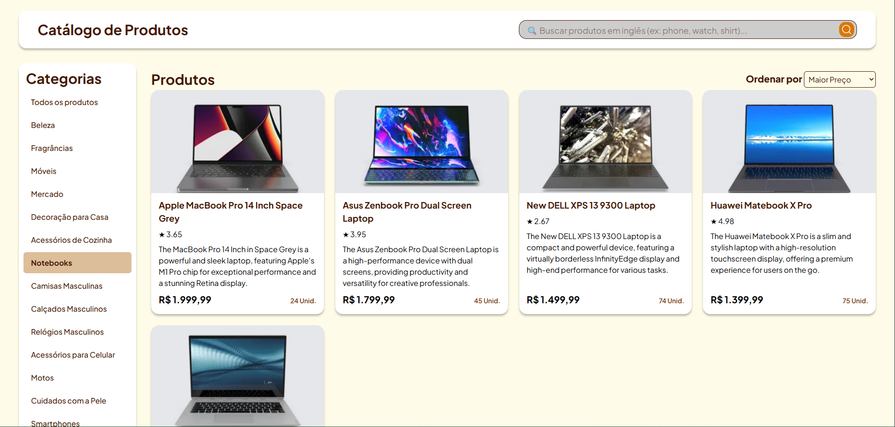
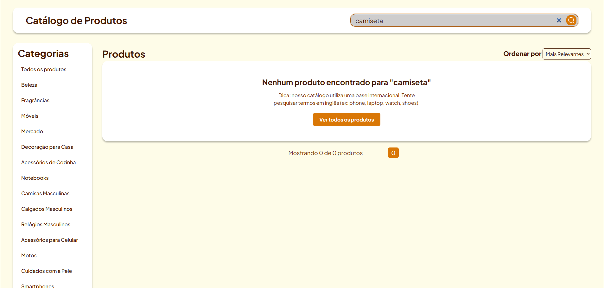
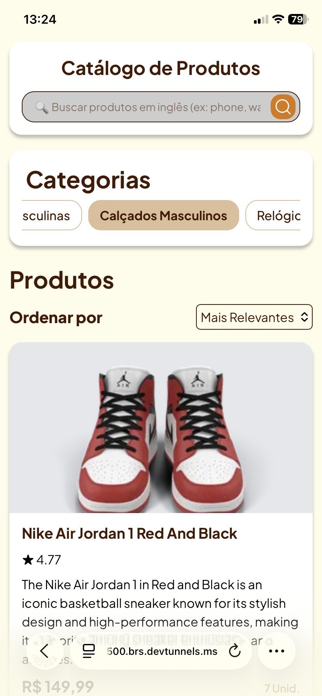

# 🛍️ Catálogo de Produtos

Aplicação web de catálogo de produtos (**SPA**) feita com **HTML, CSS e JavaScript puro**, consumindo a API pública **DummyJSON**. Permite listar, pesquisar, filtrar por categorias, ordenar por preço e paginar os resultados de forma assíncrona — atualizando a interface dinamicamente sem recarregar a página, com feedback visual de carregamento (*skeleton loading*) e tratamento para resultados vazios.

Este projeto consolida meus fundamentos em JavaScript moderno (ES6+) antes da transição para **Node.js** e **React**, aplicando arquitetura modular e fluxo de interface orientado a estado.

🔗 **Demo:** [Ver projeto online](https://seu-link-aqui.vercel.app/)

| Desktop | Estado vazio (Busca) | Mobile |
|---------|----------------------|--------|
|  |  |  |

## ✨ Funcionalidades

- Listagem dinâmica de produtos consumindo a API DummyJSON
- **Paginação completa:** navegação para primeira página, anterior, próxima, última página e indicador dinâmico de itens exibidos
- **Filtro por categorias:** delegação de eventos na sidebar (recolhível no desktop e transformada em barra horizontal deslizável no mobile/tablet)
- **Pesquisa por nome:** busca integrada ao estado da aplicação com limpeza automática ao trocar de filtro
- **Ordenação:** classificação por relevância, menor preço e maior preço
- **Skeleton Loading:** animação pulsante com a paleta do projeto enquanto os dados são carregados
- **Estado vazio (*Empty State*):** mensagem amigável com dica de busca em inglês e botão de atalho para restaurar todos os produtos
- Layout 100% responsivo (desktop, notebooks, tablets e smartphones)

## 🛠️ Tecnologias

- HTML5
- CSS3 (CSS Grid, Flexbox, Custom Properties, `@keyframes`, Media Queries e Google Fonts *Plus Jakarta Sans*)
- JavaScript (ES6+ Modules, `fetch()`, `async/await`, `URLSearchParams`)
- [DummyJSON API](https://dummyjson.com/)

## 🧠 O que eu aprendi

- **Arquitetura modular (ES Modules):** separação de responsabilidades entre camada de dados (`api.js`), interface e lógica de tela (`ui.js`) e ponto de entrada (`main.js`).
- **Fluxo unidirecional baseado em estado:** centralização de página atual, limite, categoria, ordenação e termo de busca em um único objeto `state` que guia toda a renderização da tela.
- **Consumo de API assíncrono:** requisições HTTP com `fetch()` e `async/await`, tratamento de falhas com `try/catch` e montagem segura de query strings com `URLSearchParams`.
- **Manipulação segura do DOM:** criação de elementos via `document.createElement` e `textContent` (evitando `innerHTML` para prevenir vulnerabilidades XSS), além de `replaceChildren()` para atualizações limpas.
- **Clean Code e organização:** agrupamento de seletores do DOM em cache (`elements`), constantes de configuração em `CAIXA_ALTA`, funções puras reutilizáveis e passagem de referências de funções nos eventos.
- **Experiência do Usuário (UX):** implementação de estados visuais de carregamento (*skeleton screen*), feedback claro para buscas sem resultado e prevenção de zoom automático em inputs no mobile.

## 🚀 Como rodar o projeto

1. Clone o repositório:
   ```bash
   git clone [https://github.com/brendonhenrrique/javascript-product-catalog.git](https://github.com/brendonhenrrique/javascript-product-catalog.git)
   ```
2. Abra a pasta do projeto no VS Code.
3. Inicie com a extensão **Live Server** (ou outro servidor local).

> Use um servidor local (`localhost`) em vez de abrir o `index.html` diretamente no navegador, pois a importação de **ES Modules** (`type="module"`) exige protocolo HTTP/HTTPS por política de CORS.

## 📁 Estrutura

```
├── index.html
├── LICENSE
├── README.md
└── src/
    ├── assets/
    │   ├── icon/
    │   │   └── search.svg
    │   └── screenshots/
    │       ├── desktop.png
    │       ├── mobile.png
    │       └── empty-state.png
    ├── css/
    │   └── styles.css
    └── js/
        ├── main.js
        └── modules/
            ├── api.js
            └── ui.js
```

## 👤 Autor

**Brendon**  
Desenvolvedor Frontend

- LinkedIn: [Brendon Henrique](https://www.linkedin.com/in/brendonhenrique/)
- GitHub: [Brendon Henrique](https://github.com/brendonhenrrique)